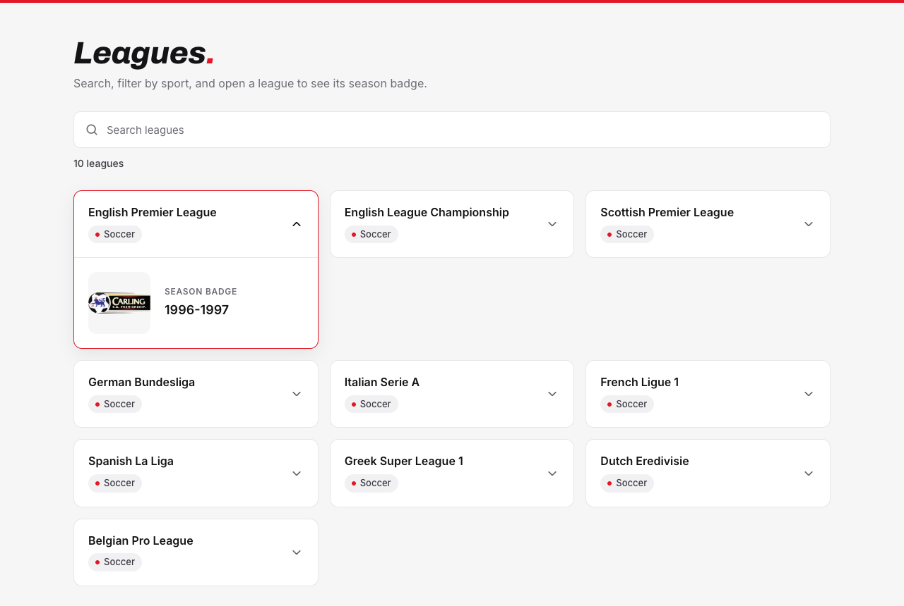
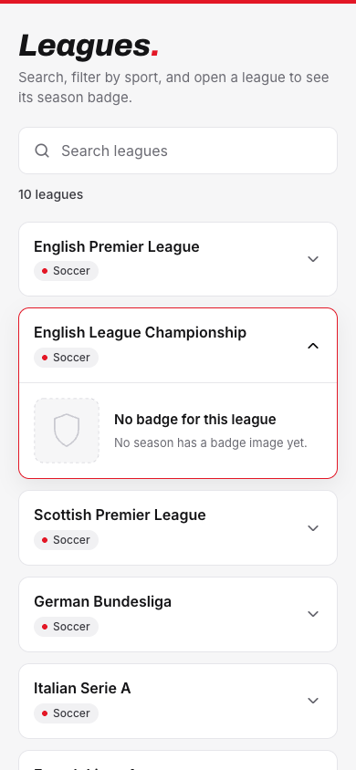

# Sports Leagues

A Vue 3 single-page app for the Sporty Group front-end take-home. It lists the leagues from TheSportsDB, filters them by name and sport, and shows a season badge when you open a league.

<p>
  
  
</p>

## Run it

Needs Node `^22.18` or `>=24.12` (CI uses Node 24).

```sh
npm ci
npm run dev                  # http://localhost:5173
npm run test:unit -- --run   # 48 tests
npm run build                # type-check and production build
npm run lint                 # fixes what it can
```

## Where each requirement lives

| Requirement                              | Implementation                                                                      |
| ---------------------------------------- | ----------------------------------------------------------------------------------- |
| Fetch and show leagues                   | `src/api/sportsdb.ts`, `src/stores/leagues.ts`, `LeagueList.vue`                    |
| Search by name                           | `LeagueFilters.vue`, `searchQuery` in the leagues store                             |
| Sport dropdown, only with several sports | `LeagueFilters.vue`, shown when the leagues store's `hasMultipleSports` is true     |
| Click a league → season badge            | `LeagueCard.vue` → `LeagueBrowser.vue` → `src/stores/badges.ts` → `LeagueBadge.vue` |
| Cache responses                          | Three layers, see below                                                             |

## How it works

- `src/api/sportsdb.ts` turns raw API data into the app's own types; API field names never leave it.
- Two Pinia stores hold the state. `LeagueBrowser.vue` is the only component that uses them; the others take props and emit events.
- **Caching, three layers:** the browser caches the leagues list for 4 hours (the API's own header). Pinia keeps the leagues and each league's badge, or "no badge", in memory, and concurrent requests share one call. Badges are also saved to `sessionStorage`, because their endpoint sends no caching headers. Failures are never cached, so Retry always tries again.
- Loading, error and no-match states each have their own UI, and a broken image has its own Retry.

## Decisions

- **Badge:** the most recent season that has one. The docs don't promise a season order, so seasons are sorted explicitly. The season name is shown because the free key's newest badges can be decades old.
- **Sport dropdown:** hidden, not disabled, when there's only one sport, as the brief says.
- **One league open at a time,** as an accessible accordion (`aria-expanded`).
- **Images:** the API's 250 px `/small` variant, 17 KB instead of 42 KB.
- **Kept small:** native `fetch` (no Axios), no custom error class, create-vue defaults.

## TheSportsDB free API: what I found

Checked against the live API and the [official docs](https://www.thesportsdb.com/documentation):

- The API splits **list and detail**: `all_leagues.php` returns only id, name and sport, by design and on every key. Everything else about a league (current season, badge, country, description) comes from `lookupleague.php?id=`, one league per request.
- Only 10 leagues, all Soccer, so the sport dropdown never appears live. Tests cover it with real NBA and Formula 1 entries.
- Only each league's 5 oldest seasons, and the seasons endpoint has no sort or "current season" option. So the Premier League's newest badge is from 1996–97, while its fixtures are from 2026–27.
- The rate limit (about 10 requests a minute in practice) returns a 429 without CORS headers. The browser sees a plain network error, so the error message mentions the limit instead.
- The leagues list is cacheable for 4 hours; badges aren't cacheable at all.

**Hidden text in the brief:** the PDF's text layer has an invisible `strDescriptionEN` after "Responses should be cached to avoid repeat calls". I treated the visible brief as the spec; see the first improvement below.

## Tests

48 Vitest tests cover the API client, both stores, and the whole app: integration tests run the real components and stores with only `fetch` faked. Fixtures are built from real API responses (trimmed, and one edited so its newest season has no badge). GitHub Actions runs lint, formatting, tests and build on pushes to `main` and on pull requests.

## Proposed improvements

Product:

1. **League details when a league opens.** One `lookupleague.php?id=` request returns the current season, the current badge and logo, country, year founded and the description (`strDescriptionEN`, most likely what the hidden text hints at). Load it only on open and cache it like the badges.
2. **Next match, last result and top-5 standings** (`eventsnextleague`, `eventspastleague`, `lookuptable`): the bookmaker's view of a league. All three work on the free key with current-season data.

Architecture:

3. **One reusable cached-request building block** for status, request sharing and persistence, so each new endpoint is a few lines rather than another store. Past two or three endpoints, TanStack Vue Query.
4. **A thin backend in front of the API in production:** keeps a paid key out of the browser, shares one cache across users, and makes rate-limit errors visible.

**Known gaps:** keyboard focus after Retry and Clear filters (the button disappears, so focus returns to the top of the page), input border contrast, a favicon, Playwright end-to-end tests, a deployed demo.

## Time spent

About 2.5 hours of active work, spread over one evening:

- **About 30 minutes:** analysing the requirements, the API documentation and the design.
- **About 1.5 hours:** implementing the core features.
- **About 30 minutes:** the remaining commits and the final review.

The brief suggests about 90 minutes. The extra time went into checking the API's real behaviour, an independent code review, and testing.

## Tools

- **Claude Code** (Anthropic, Claude Opus 5.5 model), in VS Code. Used for:
  - drafting and reviewing the implementation plan against the brief and the API documentation
  - scaffolding, code and tests
  - checks against the live API and in a real browser (Playwright)
  - drafting these notes
- **Claude Design** for the UI design: desktop, mobile, states and tokens boards. The app follows it, and the Tailwind theme tokens come from its Tokens board.
- **A separate Claude review agent** for two independent reviews: of commits 1–4 during the work, and of the finished project before publishing. It saw the code, the brief and my decisions, but not the main session's reasoning. Its findings were applied and folded into the commits they belonged to.
